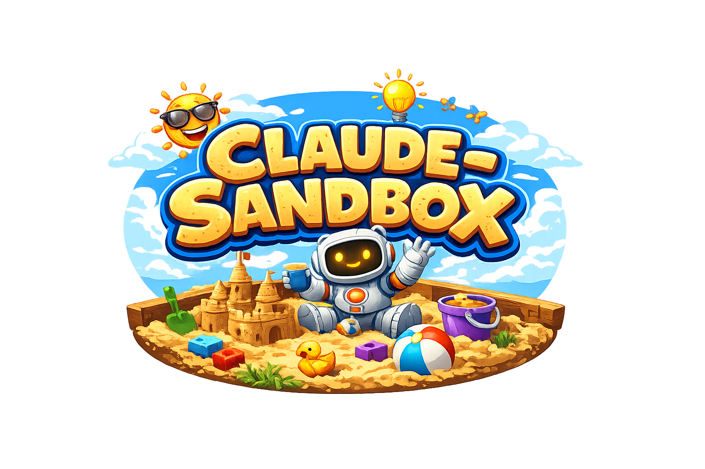

<div align="center">
  
  <p>Run AI coding agents in a container with full autonomy and none of your secrets.</p>

[](https://nsg.github.io/aibadge/#vibe)
</div>

## A personal toolbox

I built claude-sandbox for my own needs. The tools, scripts, and features in it are the ones I use, and the bundled skills — Git, Rust, testing, delegating between model vendors, and more — are written to be generic but follow how I work.

See it as a toolbox of tools, techniques, and ideas rather than a general-purpose product. If you want something similar, my recommendation is to clone this repository and ask your own AI agent to make a version for you. To pull in later changes from here, have the agent rebase your changes on top of mine — or take your copy in a completely different direction.

Suggestions and pull requests are welcome, but there is no promise that I will merge them: this is my project, built for my needs. If you want something merged, open an issue and we can discuss it.

## About

claude-sandbox runs [Claude Code](https://docs.anthropic.com/en/docs/claude-code), [OpenAI Codex CLI](https://github.com/openai/codex), [opencode](https://opencode.ai), and [t3code](https://github.com/pingdotgg/t3code) in a Podman container with a complete development toolchain. Point it at a project directory and the agent gets everything it needs to work there — compilers, a browser, a virtual display, image builds — while your host, SSH keys, and GitHub credentials stay out of reach.

When an agent does need the outside world, it goes through narrow host-side bridges you switch on per launch: an allowlisted `gh`, filtered SSH, single-repository pushes, ephemeral Incus VMs. Every request is validated and logged on the host, so you can let an agent run unattended and still know exactly what it was allowed to do.

- **One command** — `claude-sandbox` pulls the image, mounts the project, and starts the agent; the launcher, skills, and image update themselves
- **Credentials stay on the host** — GitHub, SSH, and Git push access are proxied through audited allowlists
- **Long-running agents** — run T3 Code as a systemd service with a PIN-protected portal for approvals, plan-limit usage, and a live view of the agent's display
- **Full workstation inside** — Playwright with Chromium, a headless X display, Buildah, Rust, Node.js, and ready-made skills

**Why the name?** claude-sandbox started as a sandbox around Claude Code alone. It has since grown to run Codex, opencode, and T3 Code too, but the name stayed for historical reasons. These days I mostly use it through T3 Code, which runs the different harnesses for me from a web browser or its mobile app.

## Documentation

Installation, usage, and the full reference are at **[nsg.github.io/claude-sandbox](https://nsg.github.io/claude-sandbox/)**.

## Development

### Repository layout

| Path | Contents |
|------|----------|
| `claude-sandbox/` | The launcher: a Rust binary that starts the container and runs the host-side proxies, the T3 admin portal, and the GNOME extension installer |
| `Containerfile` | The container image, published as `ghcr.io/nsg/claude-sandbox` |
| `config/` | Files baked into the image: entrypoint, in-container proxy clients, managed `AGENTS.md` and harness config |
| `skills/` | Skills installed by `claude-sandbox install skills` |
| `docs/` | The documentation site, plain HTML and CSS |
| `.github/workflows/` | CI: image, release, and documentation publishing |

### Requirements

- Rust stable, 1.85 or newer (the launcher uses the 2024 edition)
- Podman or Buildah to build the image, on x86_64
- Python 3 for the usage probe tests

### Launcher

```bash
cd claude-sandbox
cargo build
cargo test
cargo fmt --check
cargo clippy
```

Build a release binary and put it on your `PATH` to try it in place of the published one:

```bash
cargo build --release
cp target/release/claude-sandbox ~/bin/claude-sandbox
```

The launcher offers to replace it the next time a release is published.

### Container image

```bash
podman build -f Containerfile -t claude-sandbox:dev .
```

The launcher always runs `ghcr.io/nsg/claude-sandbox:latest` and pulls it on launch, so a local build checks the Containerfile but is not picked up by `claude-sandbox`. Changes reach users through CI once merged.

Run the usage probe tests from the repository root:

```bash
python3 -B config/tests/test_usage_probe.py
```

`config/AGENTS.md` must start with its only H1 heading, and `config/AGENTS.<harness>.md` overlays must contain no H1 headings; CI rejects either mistake.

### Documentation site

Edit the pages in `docs/` directly; there is no build step. Preview locally with:

```bash
python3 -m http.server -d docs 8000
```

### Continuous integration

Each workflow runs on pushes to `master` that touch its paths:

| Workflow | Trigger paths | Result |
|----------|---------------|--------|
| `container.yml` | `Containerfile`, `config/**` | Validates `AGENTS.md`, runs the probe tests, and publishes the image to GHCR; also runs twice a week |
| `release.yml` | `claude-sandbox/**`, `skills/**` | Builds the launcher and skills archives and replaces the `latest` release |
| `pages.yml` | `docs/**` | Publishes the documentation site to GitHub Pages |

## License

MIT — see [LICENSE.md](LICENSE.md) for details.
